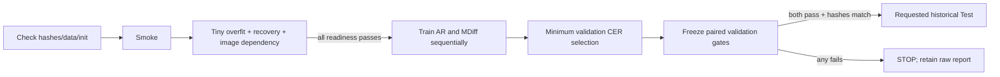

# Arabic full-line MDiff adaptation v1

**Completed experiment record:** selected checkpoints, all historical results,
failures and later hybrid experiments are in the
[current experiment README](experiments/arabic_ar_mdiff/README.md). The setup and
readiness statements below describe the original preparation workflow.

**Readiness update:** use [MDIFF_ARABIC_V1_1_READINESS.md](MDIFF_ARABIC_V1_1_READINESS.md)
and `run_mdiff_arabic_v1_1.ps1` for new runs. The original four-example readiness
subset allowed an image-width shortcut. Old reports/checks are retained; the
updated protocol uses new run names and identical readiness thresholds.

This is an implemented **Arabic adaptation**, not a faithful reproduction of
OpenOCR or a released Arabic checkpoint. No Arabic accuracy is promised.
The controlled hypothesis is that image-only mask diffusion with structured
denoising and visible-token correction improves recognition over a matched
causal Transformer with the **same pretrained visual encoder**. A gain over the
old small encoder alone cannot establish a diffusion contribution. Both new arms
must be reported, including a failed raw arm. No fallback or existing model is
promoted/replaced by this experiment.

## Sources and earlier evidence

Read-first evidence: `research/2026-10-29_transformer_diffusion_ocr/FINDINGS.md`,
its pinned method/implementation files, and the local R2/v4/v4.1 sources.
R2 already implements replacements, conditioning span dropout, clean/tail
supervision and a presence head. Those are not claimed as new features here.
The old factorized editor audit's cursor failures concern that historical editor;
this recognizer emits text slots, not cursor edit programs. v4.1 failed its
development gate; unchanged fallback scores do not establish improvement.

- Paper: https://arxiv.org/html/2512.01422v1 . Its principal tables report word
  accuracy, not CER; their numbers are not Arabic expected results.
- Official code: https://github.com/Topdu/OpenOCR at
  `1ccfc6ee6161f7133b192e16af3a9265273997ba`, main rather than the stale develop URL.
- Official weights/config: https://huggingface.co/topdu/MDiff4STR ,
  `mdiff4str_small`, revision `70c320bb8ab539ecc08f820ef94ba7679b6e40f2`.
- Checkpoint SHA256:
  `ebc96f11e5739eae98491f7c8c140157ed12b35dafa220511ef9d399cc20a937`.
- Config SHA256:
  `0abdd478db64fa06b0574f56f8c8620800bab511af0af94861b9ea73bcb219bf`.
- Code license: Apache-2.0, preserved in `mdiff_arabic_v1/vendor/LICENSE` with
  attribution/modifications in `vendor/NOTICE.md`. Official model attribution
  is preserved; no new license for the published weights is invented.

The checkpoint config has **two**, not the generic YAML's three, convolution
blocks before FGlobal in stage 2. Exact transfer of all 164 encoder tensors
(11,707,970 elements including buffers) was verified. Tensor initialization hash:
`c6fa52b3592b18971c80aa10c2f5db5a9c9cb3c73b302e595e03eb801ee6bfeb`.
`Check` records every loaded/skipped name and shape. All English decoder/head
tensors are explicitly skipped. Missing encoder keys/shapes are fatal.

## Model and deliberate adaptations

SVTRv2 small stages [3,6,3], dimensions [128,256,384], exact official weights.
No pretrained positional embedding is present (`use_pos_embed=false`). The
wrapper adds deterministic sinusoidal visual positions after a 384-to-256
projection. Three 256-wide, eight-head Transformer decoder blocks, dropout .1,
new Arabic character embedding/output, PAD=0, MASK=1, EOS=2. Both arms have
15,069,703 parameters on the verified training vocabulary and identical complete
initial state hashes. AR shares even the fixed-zero timestep module; it uses a
causal text mask and MASK as BOS. PAD/MASK cannot be predicted as output.

The original English 25-character, space-disabled recipe is **not** used.
Capacity 144 includes EOS, derived from TRAIN's maximum literal length 109 with
margin. RGB height 32, aspect-preserving width at most 640 versus TRAIN maximum
489 after resize. No flips, label reversal, word crops, width squash or automatic
truncation. Encoder executes each unpadded line separately; only a <=3-pixel white
stride-alignment border remains. Feature batch padding is masked in decoder
cross-attention. Pretrained BatchNorm running statistics stay frozen. SDPA and
activation checkpointing control memory; batch 1, accumulation 16, workers 0.
Fixed pretrained encoder choice is used in both primary arms.

Targets use logical Unicode and `no_harakat_v1`: remove only U+064B..U+0652.
Preserve tatweel, spelling, punctuation, digits, all other Unicode, leading,
trailing and repeated whitespace, and internal newline. Label files lose only
one terminal LF or CRLF. Vocabulary comes **only from TRAIN**. OOV/overlength/
image-limit issues are reported without dropping examples. Decoder output ends
at first EOS; remaining capacity is not transcript content. No-EOS is a recorded
failure; raw text is retained for metrics. PAD marks excluded loss positions,
never an attention hint to ground-truth length.

Diffusion training uses one of six uniform patterns per example: full mask,
logical prefix, logical suffix, contiguous block, one-token cloze, random subset.
At least one valid token is masked, EOS is eligible, PAD becomes MASK. Timestep
is the actual masked fraction. Masked CE is normalized by masked positions.
This structured surrogate is **not an unbiased diffusion ELBO**.

A separate correction call sees wrong visible tokens, with a random replacement
rate and 25% identity states. Replacements are guaranteed different, can include
EOS, and never include PAD/MASK. All valid target positions receive correction
CE, including correct visible tokens; no enormous preservation loss weight.
Correction timestep is fixed zero at training/inference because inference does
not know the true error rate. Total loss is .5 masked CE + .5 correction CE +
.1 separately normalized EOS-tail CE. This is two decoder passes per microbatch,
not the upstream `sample_k=3/train_all_layer` tensor scheme. No sample-dimension
settings from incompatible upstream configurations are mixed.

Inference is explicitly `masked_reflect_v1`, **3 rounds / 6 actual decoder
passes**: denoise MASK positions, then correct all visible predictions, including
confidently wrong ones. After each nonfinal round, remask the lowest-confidence
fraction (2/3, then 1/3) of the predicted prefix including EOS; hide slots after
predicted EOS. Every later denoise still evaluates full capacity and EOS can
move. The correction call can change every visible character. Tie order is
stable and output is argmax; repeated eval calls are checked for determinism.
No reference text/length or Paddle guess is accepted by production inference.
Reference-derived initial tokens are restricted to named TRAIN diagnostics.

AR trains two independently dropped-out causal CE views, averaged, so both arms
encode once and execute two decoder passes per microbatch over capacity 144.
The objective/masking differ by design. Equal epochs do not imply equal wall
compute: record optimizer updates, examples, decoder passes, training seconds,
validation seconds and peak memory. Early stopping can produce different actual
budgets. This is not the paper's multi-GPU batch-1024 training budget.

Frozen schedule: max 200 epochs, patience 30; AdamW decoder LR 3e-4, encoder LR
1e-5, weight decay .01, gradient clip 1. Warm up five epochs then cosine decay
to 10% peak. Encoder frozen for five epochs, then fine-tuned with the same
schedule in both arms. Training augmentation cycles original/photometric/safe
geometry (`trocr_views_v1`), identically seeded by sample/epoch. No synthetic
images, external language model, verifier, ensemble, dictionary or Paddle
conditioning. Primary seed 54101; confirmation seeds/ablation are later explicit
experiments, not an automatic sweep. No correction-free ablation runs here.

## Data and selection discipline

Canonical counts and manifests verified: 2103 train, 150 validation, 752 test.
Every fit/validation image, decoded RGB pixels and literal label is hash-checked.
The test manifest is hashed and its IDs/pixel identities audited, while its
text/length/character fields are ignored until a gated Test action. No test
inference is part of Check/Smoke/Overfit/Train/Validation/ValidationStats.
Canonical manifests and baselines are preserved.

The audit finds train/validation overlap on 106 pages and 23 notebook proxies;
train/test 225 pages and 30 proxies; validation/test 100 pages and 23 proxies.
These are not verified writer identities. A deterministic TRAIN-derived debug
holdout manifest keeps entire notebook proxies together; it is not called new
untouched evaluation and primary training uses all canonical TRAIN. No genuinely
untouched grouped material has been established. The historical validation/test
remain development-used. No random reshuffle or nested Paddle project is started.

Comparators are frozen Paddle, v2.2 and v4 cached outputs. Provenance verification
checks the canonical split lock, current image/label hashes, Paddle's input
fingerprints and run configuration, immutable v2.2 bundle hashes, and v4's parent
binding, preparation, selection and model hashes. Exact IDs/coverage are required;
basename/count matching alone is rejected. Reports bind the cached prediction
file hashes, without editing originals or generating new baseline predictions.

Select checkpoint by minimum validation character edits (fixed reference
denominator means minimum CER), then fewer word edits, more exact lines, earlier
epoch. Save raw per-epoch predictions/metrics, every best checkpoint, every tenth
checkpoint and the final/early-stop checkpoint; last optimizer state is atomic.
Raw selection is independent of eligibility; a lower-CER checkpoint can fail.

Promotion conditions, frozen before the long run, for **each primary arm**:

1. Strictly fewer character edits than v4.
2. No more word edits than v4.
3. Zero damaged lines among the union of v4/v2.2 exact lines.
4. Complete successful coverage, all outputs have EOS, no length failures.

The paired historical Test requires both arms to pass all conditions. This
conservative joint requirement is explicit. It does not select an alternate
epoch or fall back to an existing prediction. There is no automatic promotion.

Metrics are aggregate, unclamped (sub+ins+del)/reference characters, WER, exact
lines, denominators, whitespace edits, gained/lost exact IDs, improved/worsened/
unchanged lines, failures, missing/expected/completed coverage and runtime.
Failed outputs remain in denominators. Reports include descriptive grouped
bootstrap CER and paired CER-delta intervals (1000 draws), with notebook-proxy
and repeated-development-use limitations. They do not repair group leakage.

`validation/report.json` contains `validation_passes_release_gate`, individual
`gate_conditions`, `arms`, `models`, `selected_models`, hashes and `test_used`.
`validation/gate.json` seals the actual report/checkpoints/policy/predictions.
Python Test rechecks all hashes and recomputes validation conditions from raw
predictions **before** loading test references. Editing a boolean is insufficient.
Test output is `historical_test/report.json`, `.txt`, and joined `predictions.jsonl`.
This historical comparison is exploratory/development-used, not fresh final
generalization. Any truly new evaluation material needs new comparator outputs
with frozen provenance; caches from these old IDs cannot be substituted.

## Environment, readiness and artifacts

Verified native Windows Python 3.13.14, Torch 2.10.0+cu126 / CUDA 12.6, NumPy
2.3.2, Pillow 11.3.0, PyYAML 6.0.3. RTX 4050 Laptop GPU has 6,438,780,928 bytes
total memory and BF16 support. BF16 is the frozen CUDA recipe; CPU uses FP32.
The initial FP16 scaled-optimizer probe overflowed; BF16 corrected that without
relaxing finite-gradient checks. No packages were installed/upgraded/uninstalled.
`Setup` downloads/verifies only pinned encoder assets, and is idempotent on
matching cached files. It is not an environment installer.

`Check` refuses used run names, verifies data/environment/assets/init, and creates
an immutable source snapshot including dirty/untracked implementation files,
runner, reused data/tokenizer/images/metrics, tests and vendor license. Full
package versions plus executable/Python/CUDA/GPU are saved in environment.json
and dependencies.freeze.txt. Changed environments explain package drift and
require an explicit new run/environment; no silent refreeze/bypass.

`Smoke` is real GPU minibatch forward/backward in all intended modules, padded
memory/variable labels, exact initialization and deterministic decoding. It also
checks backward at TRAIN's widest image. The regression suite tests literal text,
EOS/PAD/overflow, wrong-visible correction, actual six calls, masked-only denoise,
causality, metric denominators, preservation damage, hashes, gate enforcement and
paired report output. Smoke is a mechanics check, not an accuracy success.

`Overfit` fits four fixed TRAIN examples without augmentation or validation use.
Strict limits: at most 1200 optimizer updates and 900 seconds for fit/diagnostics
(checked at update/example boundaries; one in-progress kernel may finish after
the deadline and then fails readiness). Reserve time for decoded probes. Success
requires >=100 updates, CER <=5%, >=75% exact lines, complete EOS, normal-image
CER at least .01 below both shuffled and blank images. Diffusion additionally
requires missing/replaced probes CER <=5% and >=75% exact, and >=75% correct-state
exact preservation. All conditions are separately reported. These are dependency
checks, not proofs of grounding. No passing flag is fabricated after a failed
short probe. Each attempt has an immutable timestamp directory and a hashed
latest pointer. The longer diagnostic command is supplied for the user to run.

`Train` refuses unless Check, Smoke and Overfit all pass with matching code,
environment, initialization, data and recipe. Runs use short names and compact
checkpoint files; full sample identities live in JSONL. Completed runs cannot be
overwritten. No new long training/final evaluation is launched during preparation.

`Train -Resume` explicitly resumes the last complete epoch of an **incomplete**
compatible run. Code/data/environment/readiness/init are rechecked, as are last
checkpoint hash and optimizer/RNG bindings. Partial epoch artifacts left after
last.json are refused rather than appended/replayed ambiguously. No Resume
action exists. Completed runs cannot resume. Save every prior experiment.

## PowerShell 5.1 workflow

Rerun the common block in a new shell. It works from PS C:\Users\ammar>.
These primary run names are reserved only by executing Check; neither training
run was created during implementation. The initial common block refuses a used
training directory; for an existing incomplete run, define the same variables
without that guard before the explicit resume command.

```powershell
$project = 'C:\Users\ammar\OneDrive\Desktop\final project'
$python = 'C:\Users\ammar\AppData\Local\Microsoft\WindowsApps\PythonSoftwareFoundation.Python.3.13_qbz5n2kfra8p0\python.exe'
$runner = Join-Path $project 'Diffusion\run_mdiff_arabic_v1.ps1'
$device = 'cuda'
$mdiffRun = 'ma1_s54101'
$arRun = 'ar1_s54101'
$runRoot = Join-Path $project 'Diffusion\drive_all\runs'
foreach ($name in @($mdiffRun, $arRun)) {
    if (Test-Path -LiteralPath (Join-Path $runRoot $name)) { throw "Run already used: $name" }
}
$common = @{ Python = $python; Device = $device }
$mdiff = @{ Arm = 'mdiff'; RunName = $mdiffRun; PeerRunName = $arRun }
$ar = @{ Arm = 'ar'; RunName = $arRun; PeerRunName = $mdiffRun }
```

Asset verification and read-only environment/data/init checks; no retraining:

```powershell
& $runner -Action Setup @common @mdiff
& $runner -Action Check @common @mdiff
& $runner -Action Check @common @ar
```

Smoke and tiny-subset fits; Overfit does train fresh diagnostic models, never the
primary run, and does not initialize the later training run with fitted weights.
If either command fails readiness, STOP and paste its report back.

```powershell
& $runner -Action Smoke @common @mdiff
& $runner -Action Smoke @common @ar
& $runner -Action Overfit @common @mdiff -OverfitUpdates 1200 -OverfitSeconds 900
& $runner -Action Overfit @common @ar -OverfitUpdates 1200 -OverfitSeconds 900
```

Two sequential long fits; run only after both readiness reports pass:

```powershell
& $runner -Action Train @common @mdiff -Epochs 200 -Patience 30
& $runner -Action Train @common @ar -Epochs 200 -Patience 30
```

Validation freezes a paired comparison using saved selected-epoch raw validation
predictions; it does not retrain or generate test predictions. ValidationStats
only reads/verifies reports and selection evidence; it does not run a model.
Validation is immutable; use ValidationStats to display it again.

```powershell
& $runner -Action Validation @common @mdiff
& $runner -Action ValidationStats @common @mdiff
$validationReport = Join-Path (Join-Path $runRoot $mdiffRun) 'validation\report.json'
$report = Get-Content -LiteralPath $validationReport -Raw -Encoding UTF8 | ConvertFrom-Json
$report.gate_conditions | ConvertTo-Json -Depth 6
```

Only after validation passes: frozen-gated **historical** Test. This generates
new predictions for both selected primary models and scores verified cached
comparators. Its Python backend independently enforces the real gate.

```powershell
$report = Get-Content -LiteralPath $validationReport -Raw -Encoding UTF8 | ConvertFrom-Json
if ($report.validation_passes_release_gate -isnot [bool] -or $report.validation_passes_release_gate -ne $true) {
    throw 'STOP: frozen validation gate did not pass. Do not run Test.'
}
& $runner -Action Test @common @mdiff
```

Locate raw reports and native logs without truncated Format-Table output:

```powershell
$checks = Join-Path $project 'Diffusion\drive_all\checks'
$logs = Join-Path $project 'Diffusion\drive_all\logs'
Get-Content -LiteralPath (Join-Path (Join-Path $checks $mdiffRun) 'overfit_latest.json') -Raw -Encoding UTF8
Get-Content -LiteralPath (Join-Path (Join-Path $checks $arRun) 'overfit_latest.json') -Raw -Encoding UTF8
Get-ChildItem -LiteralPath (Join-Path $logs $mdiffRun) -File | Select-Object -ExpandProperty FullName
```

Explicit compatible incomplete-run continuation (do not rerun a common-block
unused-name guard against the run you intend to resume):

```powershell
& $runner -Action Train @common @mdiff -Epochs 200 -Patience 30 -Resume
# Or the interrupted AR arm, after the GPU is free:
# & $runner -Action Train @common @ar -Epochs 200 -Patience 30 -Resume
```

For resume from a new shell, this complete block avoids the new-run unused-name
guard and still requires a compatible incomplete run:

```powershell
$project = 'C:\Users\ammar\OneDrive\Desktop\final project'
$python = 'C:\Users\ammar\AppData\Local\Microsoft\WindowsApps\PythonSoftwareFoundation.Python.3.13_qbz5n2kfra8p0\python.exe'
$runner = Join-Path $project 'Diffusion\run_mdiff_arabic_v1.ps1'
& $runner -Action Train -Python $python -Device cuda -Arm mdiff -RunName 'ma1_s54101' -PeerRunName 'ar1_s54101' -Epochs 200 -Patience 30 -Resume
```

Routing only, no execution/model/data access:

```powershell
& $runner -Action Train @common @mdiff -Epochs 200 -Patience 30 -DryRun
& $runner -Action Test @common @mdiff -DryRun
```

The wrapper captures LASTEXITCODE immediately, throws on nonzero, preserves/
restores error preferences, and keeps Arabic UTF-8. Harmless native stderr does
not itself mark failure. All invoked source paths are absolute; no current
directory assumption or Bash syntax/backtick continuation is needed.

Format example only, **not experiment results**:

```text
Model                        Lines   CER %   WER %  Exact %   Sub   Ins   Del
paddle                         ...     ...     ...      ...   ...   ...   ...
frozen_v2_2                    ...     ...     ...      ...   ...   ...   ...
span_hybrid_verifier_v4        ...     ...     ...      ...   ...   ...   ...
transformer_arabic_control    ...     ...     ...      ...   ...   ...   ...
mdiff_arabic_raw               ...     ...     ...      ...   ...   ...   ...
mdiff_arabic_raw: selected epoch=... | checkpoint=... | SHA256=... | Decoder=masked_reflect_v1 | Steps=3
Exact lines lost/gained vs v4: ... / ... | union damaged=...
Gate conditions: {"strictly_fewer_character_edits": ..., ...}
Validation gate: ... | Test used: false
Report: absolute path
```


